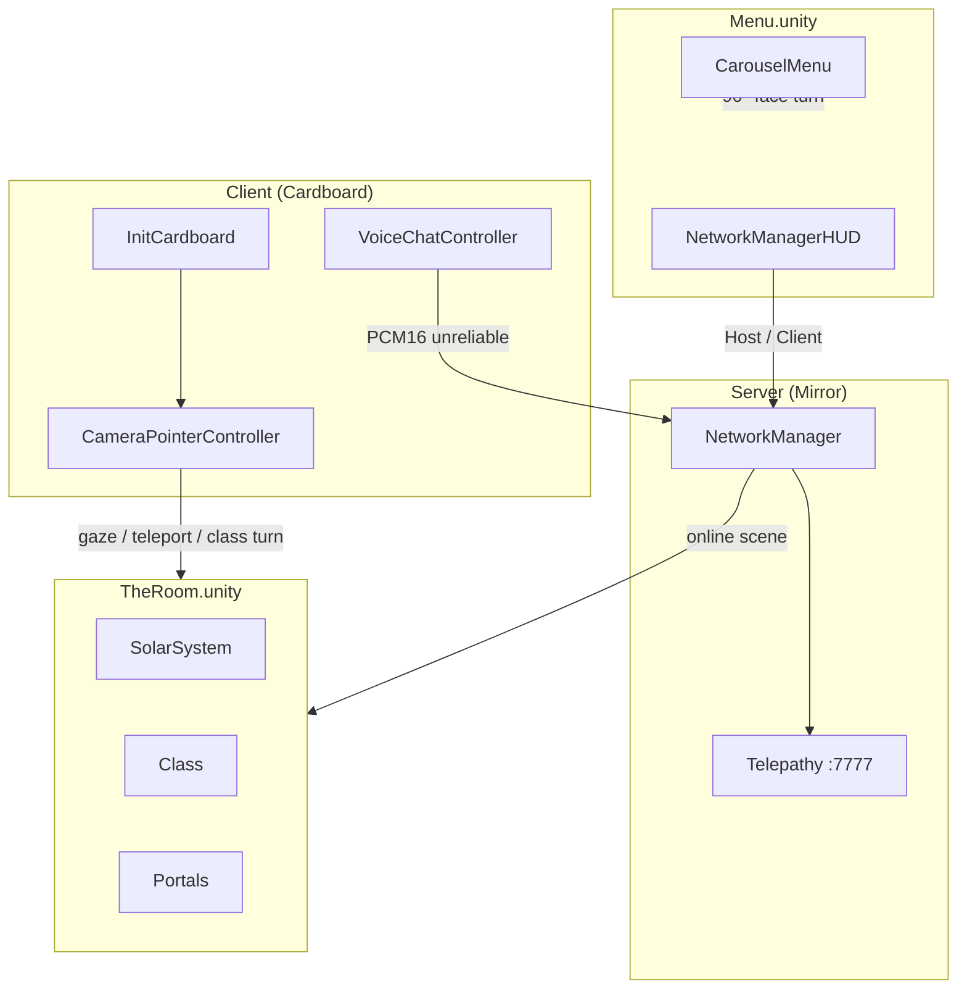

# meta-class-alpha

> **Languages:** English | [Português (BR)](README_pt.md)

Multiplayer virtual reality experience for **Google Cardboard**, where players explore an immersive room with a solar system, planets, and portals. The focus is **gaze-based** interaction and shared presence among networked participants.

## About the game

The build opens on the **Menu** scene. From there a host starts a room and Mirror loads **The Room**. In the headset, players can:

- Look at and interact with objects in the environment
- Turn the classroom 45° clockwise around the host area
- Travel with the classroom toward a celestial body and return to the room
- Teleport to the surface of celestial bodies marked as teleportable
- Talk to other players in real time via voice chat
- Navigate through spherical and cylindrical portals in the scene

The experience combines spatial exploration, hands-free interaction (gaze only), and synchronous multiplayer.

## Concepts and technologies

| Concept | Implementation |
|---------|----------------|
| **Mobile VR** | [Google Cardboard XR Plugin](https://github.com/googlevr/cardboard-xr-plugin) (`InitCardboard`) |
| **Multiplayer** | [Mirror](https://mirror-networking.com/) with **Telepathy** transport (port `7777`) |
| **Gaze interaction** | `CameraPointerController` — raycast from camera, dwell click (~3 s) |
| **Voice chat** | `VoiceChatController` — microphone capture, PCM16 streaming via Mirror (unreliable channel) |
| **Local multiplayer testing** | [ParrelSync](https://github.com/VeriorPies/ParrelSync) — project clones in the Editor |
| **UI** | TextMesh Pro + gaze progress slider. The menu uses **Montserrat Bold** |
| **Menu** | `CarouselMenu` — screen touch rotates the menu 90° in 1.5 s |

### Important tags

Defined in `ProjectSettings/TagManager.asset` and used by interaction logic:

| Tag | Purpose |
|-----|---------|
| `Interactive` | Objects that respond to `OnPointerEnter` / `OnPointerExit` |
| `Teleportable` | Surfaces the player can teleport to after completing gaze |
| `Planet` | Planetary object grouping (e.g. name shown in UI) |
| `Environment` | Static scenery, ignored by interaction |

### Gaze interaction flow

```
Camera (look direction)
    → Raycast
    → Object tagged Interactive / Teleportable / Player
    → OnPointerEnter (visual highlight via ObjectBasicController)
    → Dwell on target (~3 s, progress bar)
    → Click: action (teleport if Teleportable) or UI feedback
    → OnPointerExit when focus is lost
```

## Project architecture

```
meta-class-alpha/
├── Assets/
│   ├── Scenes/Menu.unity         # First scene in the build
│   ├── Scenes/TheRoom.unity      # Classroom, loaded as the online scene
│   ├── Scripts/                  # Game logic
│   ├── Prefabs/                  # Player, portals, treasures
│   ├── Models/                   # SolarSystem.fbx, avatar (Male_002)
│   ├── Materials/                # Skybox, sun, portals, UI
│   ├── XR/                       # Cardboard loaders and settings (Android)
│   ├── Mirror/                   # Networking library
│   ├── ParrelSync/               # Multiplayer testing in Editor
│   └── Plugins/Android/          # Gradle and manifest for Android builds
├── Packages/manifest.json        # UPM dependencies (Cardboard, etc.)
├── ProjectSettings/              # Player, XR, build, tags
├── BUILD_ANDROID.md              # APK build guide
└── extensions.list               # Recommended VS Code extensions
```

### Core components

| Script | Responsibility |
|--------|----------------|
| `InitCardboard` | Cardboard init, skybox, recentering, and app exit |
| `CameraPointerController` | Gaze, teleport, focus UI, and dwell click (`NetworkBehaviour`) |
| `CameraEditorController` | Mouse look in Editor (local player only) |
| `ObjectBasicController` | Gaze visual feedback (material swap) |
| `VoiceChatController` | Spatial voice capture and playback (`NetworkBehaviour`) |
| `SunLightController` | Point light following the Sun in the solar system |
| `UILogger` | On-screen interaction messages (TMP) |
| `CarouselMenu` | Menu faces: Criar Sala, Buscar Sala and Voltar, by screen touch |
| `MenuBackdrop` | Cover-fits the menu background to the orthographic camera |
| `ClassController` | Turns the classroom 45° around `HostArea` in 3 s and places players |
| `RotateClassButton` | Gaze click that starts that turn |
| `SolarSystemThumbHost` | A touch on the thumbnail starts the room, same as the HUD Host button |
| `RoomList` | Lists open rooms on the local network; a touch joins as client only |
| `LanRoomBeacon` | Advertises while a server is running and searches while the menu is idle |
| `LogoBounce` | Slight logo motion while the menu scene is active |

### Networking (Mirror)

- **NetworkManager** in the `Menu` scene, port **7777**, max **4** connections. It persists with `dontDestroyOnLoad`
- **Offline scene** `Menu`, **online scene** `TheRoom`. The Room does not contain a second manager
- The corner Mirror HUD still creates the room. The Portuguese labels Criar Sala and Buscar Sala only turn the carousel. A screen touch on SolarSystemThumb calls the same Host (Server + Client) action. RoomList shows open rooms on the local network, and a touch on one joins it as Client
- **Player prefab** (`Assets/Prefabs/Player.prefab`): camera, canvas, gaze, voice, and network identity
- Server starts automatically in builds (`autoStartServerBuild`)
- Client connects manually (`localhost` by default in Editor)

### Simplified diagram



## Requirements

| Tool | Version |
|------|---------|
| Unity | **6000.3.6f1** (Unity 6.3) |
| Target platform | Android (Cardboard) + Editor for development |
| IDE | VS Code, Rider, or Visual Studio |

Recommended Unity Hub modules: **Android Build Support** (SDK, NDK, OpenJDK).

## Getting started (developers)

### 1. Clone and open

```bash
git clone <repository-url>
cd meta-class-alpha
```

Open the folder in **Unity Hub** with editor **6000.3.6f1**.

### 2. Working scene

Open `Assets/Scenes/Menu.unity` and press Play from there. It is the first enabled scene in the build. `TheRoom.unity` loads when a room becomes online. Play mode uses the open scene, so starting Play inside The Room skips the menu.

### 3. Test in Editor

1. Press **Play**
2. The Mirror server starts automatically on port `7777`
3. In the Editor, `CameraEditorController` lets you look around with the mouse (local player only)
4. To test **two players** on the same PC, use **ParrelSync → Clones Manager** and open a project clone

### 4. Unit tests

The suite is **Edit Mode**, in the `MetaClass.EditModeTests` assembly. Test files live in `Editor/` folders next to each script under `Assets/Scripts/` and are not included in the player build. You do not need to open the scene or press Play.

**In the Editor**

1. Open the project in Unity **6000.3.6f1**.
2. Go to **Window → General → Test Runner**.
3. On the **EditMode** tab, select `MetaClass.EditModeTests` and click **Run All**.

**From the terminal**

Close the Editor first. A second Unity instance refuses to open the same project while it is already open.

```bash
/home/ive/Unity/Hub/Editor/6000.3.6f1/Editor/Unity \
  -batchmode -nographics \
  -projectPath "$(pwd)" \
  -runTests -testPlatform EditMode \
  -assemblyNames MetaClass.EditModeTests \
  -testResults /tmp/meta-class-editmode-results.xml \
  -logFile /tmp/meta-class-editmode.log
```

The executable path is the Unity Hub install of **6000.3.6f1**. The run summary is written to `/tmp/meta-class-editmode-results.xml`; the Editor log, to `/tmp/meta-class-editmode.log`. The process exits on its own when the tests finish.

### 5. Test on Android device

See the full guide in **[BUILD_ANDROID.md](BUILD_ANDROID.md)**.

Summary: switch platform to Android, disable App Bundle if you want an APK, then **Build** or **Build And Run**.

### 6. Local network multiplayer

1. Both devices stay on the same LAN, with the Menu scene open on the search face
2. Whoever starts the room (thumbnail or HUD Host) advertises it. The other device's list shows `address:port` within about 3 s
3. A touch on that item joins as client. The host does not see its own room, and an item disappears after about 7 s without a fresh advertisement
4. Port **7777** must be open in the firewall. Two processes on the same machine may not see each other, because the advertisement is not looped back to the sender

## Prefab structure

| Prefab | Description |
|--------|-------------|
| `Player.prefab` | Networked player: VR camera, gaze, voice, HUD |
| `Sphere Portal.prefab` | Interactive spherical portal |
| `Cylinder Portal.prefab` | Interactive cylindrical portal |
| `Treasure.prefab` | Collectible / interactive object |

## VS Code extensions

Recommended list in `extensions.list`. To install on a new machine:

```bash
cat extensions.list | xargs -I {} code --install-extension {}
```

To update the list after installing new extensions:

```bash
code --list-extensions > extensions.list
```

Current extensions: C#, Unity Tools, Unity Debug, DocComment.

## Player settings (Android)

| Field | Value |
|-------|-------|
| Package Name | `com.EbonLabs.metaclassalpha` |
| Version | `0.1` (versionCode: 1) |
| Min API Level | 25 |
| Scripting Backend | IL2CPP |
| Architectures | ARMv7 + ARM64 |

## Additional documentation

- [docs/arquitetura.md](docs/arquitetura.md) — architecture: generic features, the Menu scene, and how The Room applies them (PT)
- [docs/codigo-limpo.md](docs/codigo-limpo.md) — agent reference for architecture, Clean Code, SOLID, and tests (PT)
- [docs/seguranca.md](docs/seguranca.md) — network, voice, and Android manifest risks, with a mitigation for each (PT)
- [docs/TDD-sala-observacao-controle.md](docs/TDD-sala-observacao-controle.md) — TDD for the observation and control room (descriptive panel done; control room and return portal still to do, PT)
- [BUILD_ANDROID.md](BUILD_ANDROID.md) — build and install APK ([PT](BUILD_ANDROID_pt.md))
- [Mirror Documentation](https://mirror-networking.com/docs/)
- [Cardboard XR Plugin](https://github.com/googlevr/cardboard-xr-plugin)
- [ParrelSync Wiki](https://github.com/VeriorPies/ParrelSync/wiki)

## License and credits

- **Company:** EbonLabs
- **Product:** meta-class-alpha
- Third-party libraries: Mirror, Google Cardboard XR, ParrelSync, TextMesh Pro
- Menu typeface: [Montserrat](https://github.com/JulietaUla/Montserrat) Bold, SIL Open Font License (`Assets/Fonts/OFL.txt`)
