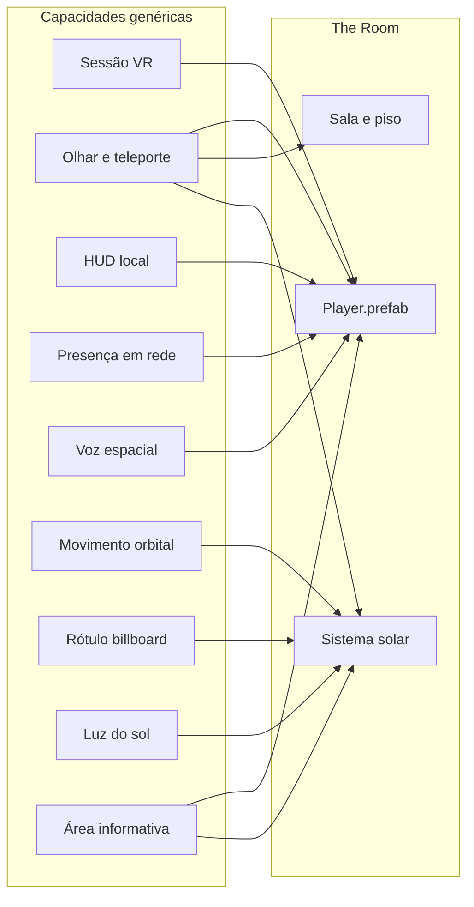
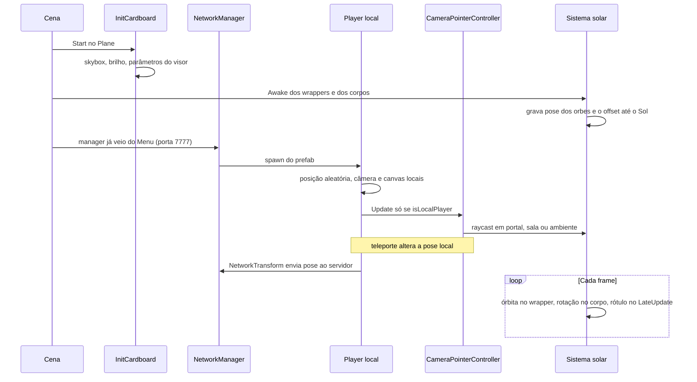

# Documento de Arquitetura

**Projeto:** meta-class-alpha  
**Cenas de build:** `Assets/Scenes/Menu.unity` (primeira), depois `Assets/Scenes/TheRoom.unity`  
**Escopo:** funcionalidades implementadas e a forma como o menu e a cena The Room as compõem  
**Fora de escopo:** sala de controle e portal de retorno descritos em [TDD-sala-observacao-controle.md](TDD-sala-observacao-controle.md), que ainda não estão implementados. O painel descritivo desse TDD está feito (`InfoArea` e `SceneInfoPanel`, seções 2.13 e 3).  
**Código novo:** [codigo-limpo.md](codigo-limpo.md) — arquitetura, Clean Code, SOLID e testes.

Este documento separa duas camadas. A primeira descreve capacidades genéricas: scripts e contratos que não conhecem a sala, os planetas nem o enredo da experiência. A segunda descreve como The Room instancia essas capacidades, qual é a hierarquia da cena e como os objetos se relacionam em runtime.

---

## 1. Ideia central

O projeto é uma experiência de realidade virtual para Google Cardboard, com presença compartilhada via Mirror. A interação do jogador é o olhar: um raycast sai da câmera, um tempo de permanência confirma a ação e o resultado depende da tag do objeto atingido.

A simulação do mundo (órbita, rotação, rótulos, luz) roda em cada cliente a partir dos mesmos parâmetros. Só a presença do jogador e a voz atravessam a rede. Isso mantém os sistemas de cena independentes do transporte e limita o que precisa ser autoritativo.

O projeto também pode ser uma plataforma aberta para o ensino de computação gráfica, modelagem 3D e programação, por exemplo um curso de Unity. Um dos objetivos é que jovens iniciantes colaborem com novas salas usando o projeto como framework e como caso de uso. Assim aprendem enquanto contribuem com um jogo real, já em produção e disponível para a comunidade.



---

## 2. Funcionalidades genéricas

Cada bloco abaixo pode ser reutilizado em outra cena desde que os contratos (tags, nomes de âncora, prefabs) sejam respeitados. Nenhum deles referencia objetos exclusivos de The Room além de nomes de busca do Sol (`Sun Sphere`, `Sun`, `SUN`) e da raiz `SolarSystem`, usados só para localizar o centro orbital.

### 2.1 Sessão de realidade virtual

| Peça | Papel |
|------|--------|
| `InitCardboard` | Sobe o dispositivo Cardboard, aplica o skybox, impede o sono da tela e trata os botões do visor |

No `Start`, o script aplica o material de céu configurado e, se a câmera estiver em cor sólida, passa o clear flag para skybox. Em `Update` trata o ciclo do visor: escanear parâmetros do aparelho, recarregá-los quando mudam, recentralizar a visão com o gatilho e encerrar o aplicativo no botão de fechar. Fora do Editor, atualiza os parâmetros de tela a cada frame.

O script não conhece jogador, rede nem objetos interativos. Qualquer objeto da cena pode carregá-lo.

### 2.2 Presença multiplayer

A rede usa Mirror com transporte Telepathy. O contrato genérico é:

- um `NetworkManager` na cena, com um prefab de jogador e um transporte;
- o jogador é o único objeto spawnado pela rede;
- posição e rotação do dono seguem para o servidor (`NetworkTransform` com `SyncDirection.ClientToServer`) e dali para os demais clientes;
- câmera, canvas e listener existem no prefab, mas só o jogador local os liga.

Parâmetros atuais do manager, reutilizáveis como padrão do projeto: porta **7777**, no máximo **4** conexões, `dontDestroyOnLoad`, `autoStartServerBuild` ligado e `autoConnectClientBuild` desligado. O endereço padrão no Editor é `localhost`. O manager vive na cena Menu, com cena offline `Menu` e cena online `TheRoom`. The Room não carrega um segundo `NetworkManager`. O HUD de canto do Mirror continua sendo o controle que cria a sala.

`CameraPointerController.OnStartClient` posiciona o jogador local numa área aleatória próxima da origem (`x` e `z` entre 0 e 3, `y = 1`) e habilita câmera e canvas somente quando `isLocalPlayer` é verdadeiro.

### 2.3 Olhar, permanência e teleporte

`CameraPointerController` é um `NetworkBehaviour`, mas o raycast e o clique rodam só no jogador local. A rede entra depois, quando o `NetworkTransform` replica a nova pose.

Fluxo, independente do conteúdo da cena:

1. Um raio sai da posição da câmera na direção `forward`, sem limite de distância. Colliders em modo trigger são ignorados (`QueryTriggerInteraction.Ignore`), para o volume de uma `InfoArea` não roubar o foco.
2. Se o alvo muda, o objeto anterior recebe `OnPointerExit` e o novo pode receber `OnPointerEnter`.
3. Objetos com tag `Environment` não entram em foco. O mesmo vale para um alvo de teleporte em cuja borda o observador já está, e para o alvo recém-usado (o ponteiro fica desarmado até o olhar sair dele).
4. Enquanto o foco permanece, um contador avança. O tempo padrão de confirmação é **3 segundos**. Um slider mostra a fração decorrida.
5. Ao completar o tempo, `handlePointerClick` dispara. Se a tag é `Teleportable`, o jogador é movido para um ponto na superfície do volume do alvo, com uma margem de 0,05 unidade para fora, e o ponteiro daquele alvo é desligado. Outras tags só registram o clique no HUD.

`OnPointerEnter` e `OnPointerExit` são enviados com `SendMessage` apenas para as tags `Interactive`, `Teleportable` e `Player`. O destaque visual fica a cargo de quem implementar esses métodos, em geral `ObjectBasicController`.

O nome exibido no HUD tem uma convenção: se o pai do alvo tem tag `Planet`, a mensagem é `Planeta: <nome do pai>`. Caso contrário, usa o nome do próprio objeto.

### 2.4 Feedback visual de foco

`ObjectBasicController` troca o material do `Renderer` do próprio objeto entre um material inativo e um material de olhar. As trocas usam instâncias estáveis, para que um shader com animação de tempo continue correndo entre entrar e sair do foco. Não decide o que o clique faz.

### 2.5 HUD local

`UILogger` escreve uma string num `TextMeshProUGUI`. Não formata mensagens e não fala com a rede. Quem define o texto é o controlador de olhar.

O indicador de progresso é um `Slider` filho do jogador, ativado só durante a permanência. O ícone do ponteiro troca de sprite entre ocioso e focado.

### 2.6 Olhar no Editor

`CameraEditorController` gira o transform do jogador local com o mouse e trava o cursor. Existe para testar a mesma câmera do gaze sem o visor. Em build, o `Start` retorna cedo; o `Update` ainda lê o mouse se houver um jogador local.

### 2.7 Voz espacial

`VoiceChatController` captura o microfone do jogador local e reproduz a voz dos outros com áudio espacial.

| Etapa | Comportamento |
|-------|----------------|
| Captura | Microfone em loop, 16 kHz, bloco de cerca de 100 ms |
| Envio | PCM16 num `[Command]` no canal unreliable do Mirror |
| Recepção | `[ClientRpc]` com `includeOwner = false`; o clipe é enfileirado no `AudioSource` de quem falou |
| Espacialização | `spatialBlend = 1`, rolloff linear, 1 m a 25 m |

No Android, o script pede permissão de microfone antes de gravar. O `AudioListener` do prefab começa desligado e só o jogador local o habilita, para não haver vários listeners na cena.

### 2.8 Simulação orbital

O movimento celeste está em `Assets/Scripts/SolarSystem/` e não depende de rede.

| Tipo | Responsabilidade |
|------|------------------|
| `SolarPlanetId` | Identidade científica: Mercúrio a Netuno |
| `PlanetScientificCatalog` | Semi-eixo em UA, período orbital em dias, dia sideral em horas (negativo = retrógrado) e obliquidade |
| `PlanetOrbitCalculator` | Velocidade angular da translação e posição em volta de um centro |
| `PlanetSpinCalculator` | Velocidade angular da rotação e quaternion local, com sinal retrógrado |
| `SolarSystemLocator` | Acha o transform do Sol por nome |
| `PlanetOrbitMotion` | Aplica órbita ou rotação num transform |
| `SolarSystemMotionController` | Propaga tempo, escala de distância e visibilidade para os filhos |

Dois eixos de movimento ficam em objetos diferentes de propósito. Órbita e rotação no mesmo transform brigam com a pose local dos filhos. O padrão é:

- o **wrapper** orbita o Sol e não gira (`enableOrbit` ligado, `enableSpin` desligado);
- o **corpo** filho gira no lugar e não translada (`enableSpin` ligado, `enableOrbit` desligado).

`PlanetOrbitMotion` grava a pose local dos filhos cujo nome começa com `InteractionOrb` e a restaura no `LateUpdate`, para o marcador não derivar quando o pai é movido. Rótulos ficam de fora desse travamento: eles próprios ajustam escala e pose.

A escala de distância é a da órbita da Terra em unidades de cena. O catálogo fixa o máximo em **300**. Os outros planetas mantêm a proporção em unidades astronômicas (`semiMajorAxisAu * earthOrbitSceneUnits`). O `timeScale` padrão **4320** comprime um dia sideral da Terra para cerca de 20 segundos reais.

`useSolarDistanceScale` começa ligado: o wrapper acompanha o `distanceScale` do controlador. Uma lua desliga o flag. O raio gravado em volta do planeta permanece, em vez de ser reescrito como se fosse um semi-eixo em unidades astronômicas. O `orbitCenter` é qualquer transform. Nos planetas é o Sol; numa lua é o centro do planeta. `SolarSystemMotionController` só chama `SetOrbitDistanceScale` quando a órbita está ligada e o flag também.

O centro da malha não coincide com o pivô do wrapper. `PlanetOrbitMotion` mede esse deslocamento no renderer do filho que só gira e coloca o wrapper em `PivotForVisualCenter`, para o centro visível permanecer sobre o círculo. Com `ensureOrbitClearsSun` ligado, o raio mínimo é `(raio do Sol + raio do corpo) × 1,35`. O raio do Sol vem do `SphereCollider` vezes a maior escala; sem collider, dos limites do renderer. A Lua deixa esse flag desligado.

`SolarSystemMotionController` observa os próprios campos e só reaplica o que mudou: `timeScale`, `distanceScale`, `showInteractionOrbs` e `showPlanetLabels`. Orbes são objetos filhos cujo nome começa com `InteractionOrb`. Rótulos são componentes `PlanetLabel`. A ordem de execução é `-100`, antes do movimento (`1000`) e dos rótulos (`1100`).

O controlador não é `NetworkBehaviour`. Cada cliente simula o sistema com os mesmos números iniciais. Não há sincronização de fase orbital.

### 2.9 Rótulos que mantêm tamanho aparente

`PlanetLabel` escreve um nome num TextMesh Pro e escala o transform para que a altura aparente acompanhe o `fontSize`, independente da distância até a câmera local. A rotação de billboard fica no material (`LiberationSans SDF Billboard`); o script preserva a rotação autoral e só corrige posição local e escala no `LateUpdate`.

A câmera usada é a do `NetworkClient.localPlayer`. Sem rede, cai para a primeira câmera ativa. `SetVisible` liga ou desliga o objeto e é o gancho do controlador do sistema solar.

O texto vem de `overrideText`. Se estiver vazio, o script sobe nos pais, acha um `PlanetOrbitMotion` com órbita ligada e usa `PlanetProfile`.

### 2.10 Luz e substituição do Sol

`SunLightController` (`ExecuteAlways`) mantém uma luz pontual na posição do Sol. Cor quente, intensidade e alcance configuráveis, temperatura de cor 5778 K. A busca do Sol segue os mesmos nomes de `SolarSystemLocator`.

`SolarSystemSunReplacer` copia pose e escala de um Sol antigo (`SUN`, `Sun` ou `Sphere.009`) para um objeto `Sun Sphere` e remove o antigo. Serve para trocar a malha do modelo importado sem perder o centro que a órbita e a luz já usam.

### 2.11 Camada de nuvens

`PlanetCloudLayer` cria, se ainda não existir, um filho `Clouds`: a mesma malha da superfície, escala ligeiramente maior (`shellScale` 1,01) e um material de nuvem sem sombra. Se o material não estiver atribuído, não faz nada. É um complemento visual do corpo, sem collider próprio de interação.

### 2.12 Contrato de tags

Definidas em `ProjectSettings/TagManager.asset`. A lógica genérica depende delas, não do nome do modelo.

| Tag | Efeito |
|-----|--------|
| `Interactive` | Recebe enter/exit de olhar. O clique só atualiza o HUD |
| `Teleportable` | Igual à anterior e, ao completar a permanência, move o jogador para a borda do volume |
| `Planet` | Não é alvo de teleporte. Serve para agrupar o corpo e nomear o HUD quando o filho focado tem essa tag no pai |
| `Player` | Recebe enter/exit. Identifica o avatar em rede |
| `Environment` | O raycast acerta, mas o foco não começa |

### 2.13 Painel descritivo por área

`SceneInfoPanel` fica no jogador e escreve num `TextMeshProUGUI` separado do `UILogger`. `Show(source, text)` empilha a origem; se duas áreas valem ao mesmo tempo, o texto da última entrada fica visível. `Hide(source)` tira essa origem da pilha. Texto vazio equivale a esconder. Com a pilha vazia, o objeto `SceneInfo` fica desligado. O `Awake` só esconde o painel se ainda não houver origem, para não apagar um texto que a área já tenha mostrado no mesmo frame.

`InfoArea` exige um `SphereCollider` e o força como trigger. Não usa `OnTriggerEnter`: o jogador não tem collider nem rigidbody. A cada `Update` o script compara a posição do `SceneInfoPanel` do jogador local com a esfera no espaço local do volume (`InverseTransformPoint`), o que continua válido com pais escalados e depois de um teleporte. Só `NetworkClient.localPlayer` é consultado. Ao desligar o componente, se o jogador local estava dentro, o painel esconde aquela origem.

O campo `body` é o texto mostrado. O valor padrão do prefab é uma frase de Lorem ipsum. A cena substitui esse texto pelo parágrafo de cada corpo.

### 2.14 Sala de aula em movimento

`ClassController` gira o objeto da sala e posiciona os jogadores nas áreas. `MoveToEdge` leva o mesmo sujeito até um corpo celeste. Os dois prendem os objetos com tag `Player` em `PassengerHold` durante o deslocamento e os soltam no fim. A rotação do jogador não é escrita à parte: ela acompanha o pai.

| Ação | Comportamento |
|------|----------------|
| `RotateClassButton` | Clique de olhar. A sala gira **45°** no sentido horário em torno da posição mundial da `HostArea` capturada no clique. Dura **3 s**, com SmoothStep (`EdgeApproach`). Sem `HostArea`, o pivô é o próprio transform da sala |
| Viagem ao astro | `MoveToEdge` leva o centro da sala (`Class Center`) até a borda do destino, estacionando em **Y = 8**. Duração padrão **7 s**. A volta para casa conserva a altura de origem capturada |
| `GoHomeOrb` | O anfitrião volta para `HostArea`; o cliente, para `GuestArea`. O texto do HUD é "Voltar à sala" |

O sentido horário do projeto é yaw negativo: `Quaternion.AngleAxis` com ângulo negativo no eixo Y.

### 2.15 Menu anterior à sala

A cena Menu é a primeira do build. Ela não tem jogador local, então o gaze não dirige os cliques. O toque é na tela (`TouchPhase.Ended`; no Editor, o mouse solto quando não há toque).

`CarouselMenu` fica no pai das três faces (`MainMenu`, `CreateMenu`, `EnterMenu`). Um toque gira esse pai **90°** em **1,5 s**:

| Objeto | Rótulo | Passo |
|--------|--------|-------|
| `Create` | Criar Sala | +90° horário |
| `CreateBack` | Voltar | −90° |
| `Enter` | Buscar Sala | −90° |
| `EnterBack` | Voltar | +90° horário, mesmo sentido de Create |
| `TutorialButton` | Instruções | nenhum: o toque mais perto desse rótulo não gira |

O acerto usa os limites visíveis do renderer, com **48 px** de folga, e escolhe o rótulo cujo centro na tela está mais perto do toque. Só entra o rótulo virado para a câmera. Cantos atrás da câmera são ignorados. Esses rótulos não chamam `StartHost` nem `StartClient`. O toque em `SolarSystemThumb` chama `NetworkManager.StartHost()`, a mesma ação do botão Host (Server + Client) do HUD, e só enquanto não há sessão ativa. A miniatura também precisa estar virada para a câmera, para não criar sala a partir da face de busca. O clique numa sala da lista é testado antes da miniatura.

`LanRoomBeacon` nasce em runtime no `NetworkDiscovery`, quando `RoomList` liga. Servidor ativo anuncia a sala; cliente que não é servidor para a busca; sem sessão, a busca começa. O anúncio é UDP em broadcast, porta **47777**, a cada **3 s**. `RoomList` guarda cada sala pelo `serverId` e apaga as que ficam mais de **7 s** sem anúncio novo. O componente fica no campo TMP da face de busca: o campo é só leitura, e sem salas o placeholder da cena continua visível. Cada sala é uma linha (apelido, ou host e porta). O toque na linha entra só como cliente (`StartClient` com o URI da sala) e não cria outra sala. O anfitrião não lista a própria sala.

O fundo é `eduverso_logo_bg_menu.png` no shader `Custom/MenuBackdrop`. `MenuBackdrop` cobre a câmera ortográfica em 16:9. O objeto `Logo` é uma Image em canvas World Space com `eduverso_logo.png` e oscila na vertical enquanto a cena está ativa (`LogoBounce`, amplitude **0,35**, período **1,6 s**). Na face de criar, `SolarSystemThumb` é outra Image, com `solar_system_thumb`. Os TextMeshPro do menu usam o atlas `Montserrat-Bold SDF`. O material das letras e o da miniatura `SolarSystemThumb` usam Cull Back (`_CullMode` 2), então as costas ficam ocultas.

### 2.16 Botões da sala

O clique continua sendo o de olhar. O ícone de marcadores, voz, ritmo da órbita e distância mostra o estado oposto ao atual. O do chão mostra a ação seguinte: chão oculto exibe revelar; chão visível exibe ocultar.

| Botão | Clique | Ícone |
|-------|--------|-------|
| `MarkerControlButton` | Alterna os orbes de interação | Orbes visíveis mostram o ícone de ocultos |
| `MuteControlButton` | Alterna o silêncio dos convidados. O anfitrião não entra nesse silêncio | Convidados silenciados mostram o ícone de voz |
| `OrbitControlButton` | Alterna o `timeScale` | Ritmo acelerado mostra o ícone do ritmo comum. Na distância próxima o botão trava, o collider desliga e a cor cai para cinza 0,55 |
| `DistanceControlButton` | Alterna a escala de distância | Escala próxima mostra o ícone da escala comum |
| `GroundControlButton` | Alterna a ocultação das áreas de chão | Chão oculto mostra revelar |
| `ScreenControlButton` | `Play`, `Pause` ou `Stop` no `MainScreen` pai | Sem troca de ícone |

---

## 3. Aplicação na cena The Room

The Room é a cena online. O build começa no Menu e o Mirror a carrega quando a sala fica online. Ela compõe as capacidades da seção 2 em três grupos — infraestrutura de sessão, sala próxima ao jogador e sistema solar em escala.

### 3.1 O que a cena é

Uma sala com piso, alguns objetos ao alcance do olhar e, ao redor, o sistema solar em órbita. O jogador nasce perto da origem, olha os objetos da sala ou os portais presos aos corpos celestes e, ao sustentar o olhar num portal, é colocado na borda desse portal. Outros jogadores aparecem como avatares com voz espacial. O céu estrelado e a esfera de fundo fecham o ambiente.

### 3.2 Hierarquia

Raízes da cena:

```
TheRoom
├── EventSystem             UI
├── SpaceSphere             esfera de fundo, escala 50000
├── Interactive             objetos da sala
│   ├── Treasure
│   ├── Chair               instância de Cylinder Portal
│   └── Sphere Portal
└── Environment
    ├── Plane               piso, tag Environment; carrega InitCardboard
    ├── Sun Light           luz pontual, tag Environment
    └── SolarSystem.fbx     modelo importado
        ├── Sun Sphere      prefab do Sol, com um Portal
        └── um wrapper por planeta
```

Cada planeta segue o mesmo molde. O nome `JupterWrapper` / `Jupter` é o nome autoral da cena para Júpiter.

```
MercuryWrapper | VenusWrapper | EarthWrapper | MarsWrapper
JupterWrapper | SaturnWrapper | UranusWrapper | NeptuneWrapper
├── <Planeta>                 malha do FBX, tag Planet, só rotação
│   ├── Portal                Sphere Portal, tag Teleportable
│   └── Clouds                só Terra e Vênus
├── PlanetLabel               texto com o nome do corpo
├── InfoArea                  esfera trigger; texto curto daquele corpo
└── InteractionOrb            partículas; pose local travada pelo wrapper
```

A Terra acrescenta o centro visual da malha e a Lua. O pivô do wrapper não coincide com o globo, então a órbita da Lua usa `EarthCenter`, filho do wrapper e não da malha que gira.

```
EarthWrapper
├── Earth                     malha, tag Planet, só rotação
│   ├── Portal
│   └── Clouds
├── EarthCenter               centro da malha visível; não gira
├── MoonWrapper               órbita a Terra; useSolarDistanceScale desligado
│   ├── Moon                  esfera Unity, tag Planet, só rotação
│   │   └── Portal
│   ├── PlanetLabel           texto "Moon"
│   ├── InfoArea
│   └── InteractionOrb
├── PlanetLabel
├── InfoArea
└── InteractionOrb
```

A Lua acompanha a Terra em volta do Sol porque `MoonWrapper` é filho de `EarthWrapper`. O corpo é uma esfera primitiva com material cinza Standard (`Material.013`). O raio local é cerca de 27,3% do raio visível da Terra (1737 km / 6371 km): escala uniforme **0,017628** sobre a primitiva, cujo raio de malha é 0,5. A distância ao `EarthCenter` é **195** unidades de cena, cerca de 60,3 raios terrestres (384 399 km). O eixo da órbita está inclinado **5,145°** em relação ao eixo Y da eclíptica da cena, `(0, 0,995971, 0,089677)`. O período é **27,322** dias. A rotação do corpo usa **655,728** horas e obliquidade **6,68°**, o mesmo ritmo da translação. `ensureOrbitClearsSun` fica desligado. O perfil científico no componente é o da Terra só como valor serializado; `applyScientificProfileOnAwake` está desligado, e a Lua não entra em `SolarPlanetId`.

O jogador não está na hierarquia salva. O `NetworkManager` instancia `Assets/Prefabs/Player.prefab` ao conectar.

```
Player                        tag Player
├── câmera, listener, gaze, editor, NetworkIdentity, NetworkTransform, voz
├── Canvas                    World Space, desligado até ser o jogador local
│   ├── Text (TMP)            mensagem do UILogger
│   ├── SceneInfo             texto da InfoArea; começa desligado
│   ├── Loader / Slider       barra dos 3 segundos
│   └── Icon                  sprite ocioso ou focado
└── Male_002                  avatar visual
```

`SceneInfoPanel` está na raiz do Player, com referência ao objeto `SceneInfo` e ao texto TMP dele.

### 3.3 Como cada funcionalidade aparece na cena

| Funcionalidade genérica | Onde vive em The Room |
|-------------------------|------------------------|
| Sessão VR | `InitCardboard` no `Plane`, com o material de skybox estrelado |
| Presença em rede | O `NetworkManager` veio do Menu e permanece com `dontDestroyOnLoad`. Jogadores spawnados a partir de `Player.prefab` |
| Giro da sala | `ClassController` na Class; `RotateClassButton` dispara os 45° em torno da `HostArea` |
| Volta à sala | `GoHomeOrb`; anfitrião em `HostArea`, cliente em `GuestArea` |
| Olhar e teleporte | `CameraPointerController` no Player. Alvos reais de teleporte são os portais, não as malhas dos planetas |
| Feedback de foco | `ObjectBasicController` em `Sphere Portal`, `Cylinder Portal` e `Treasure` |
| HUD | Canvas do Player, à frente da câmera em World Space |
| Olhar no Editor | `CameraEditorController` no Player, sensibilidade cerca de 10 |
| Voz | `VoiceChatController` e `AudioSource` no Player; os outros ouvem na posição do avatar |
| Órbita | `PlanetOrbitMotion` em cada `*Wrapper`, centro no Sol, `SolarSystemMotionController` na raiz do FBX. O wrapper se desloca para o centro da malha ficar no círculo. A folga contra o Sol vale para os planetas; a Lua orbita `EarthCenter`, não segue o `distanceScale` solar e não aplica essa folga |
| Botões da sala | Marcadores, voz, ritmo, distância, chão e tela. O ícone dos quatro primeiros é o oposto do estado atual |
| Rotação | `PlanetOrbitMotion` na malha de cada planeta e na Lua, com o perfil científico correspondente. Na Lua o perfil não é reaplicado no `Awake` |
| Rótulos | Uma instância de `PlanetLabel.prefab` por wrapper de planeta e mais uma no `MoonWrapper`, com `overrideText` igual ao nome do corpo |
| Painel descritivo | `SceneInfo` no Canvas do Player. Uma `InfoArea` em cada wrapper de planeta, no `MoonWrapper` e no Sol |
| Luz | `Sun Light` segue `Sun Sphere` |
| Nuvens | Filhos `Clouds` já presentes em Terra e Vênus. `PlanetCloudLayer` existe como script e não está atribuído na cena |
| Marcadores | Um `InteractionOrb` por wrapper de planeta e um no `MoonWrapper`, visíveis porque `showInteractionOrbs` está ligado |

Parâmetros do controlador na cena: `timeScale = 4320`, `distanceScale = 300`, orbes e rótulos visíveis. Com a Terra em 300 unidades, os raios de órbita gravados nos wrappers são as proporções do catálogo:

| Corpo | Perfil | Raio de órbita | Período (dias) | Dia sideral (h) | Obliquidade |
|-------|--------|----------------|----------------|-----------------|-------------|
| Mercúrio | 0 | 116,1 | 87,969 | 1407,6 | 0,034° |
| Vênus | 1 | 216,9 | 224,701 | −5832,6 | 177,36° |
| Terra | 2 | 300 | 365,256 | 23,934 | 23,44° |
| Marte | 3 | 457,2 | 686,98 | 24,623 | 25,19° |
| Júpiter | 4 | 1560,9 | 4332,59 | 9,925 | 3,13° |
| Saturno | 5 | 2861,1 | 10759,22 | 10,656 | 26,73° |
| Urano | 6 | 5757,3 | 30688,5 | −17,24 | 97,77° |
| Netuno | 7 | 9020,7 | 60182 | 16,11 | 28,32° |
| Lua | — | 195 em volta da Terra | 27,322 | 655,728 | 6,68° |

Vênus e Urano usam dia sideral negativo: a rotação do corpo é retrógrada. Os wrappers dos planetas não giram; só transladam em torno do eixo Y do Sol. A Lua translada em torno de `EarthCenter`, com o eixo inclinado 5,145°, e o corpo gira no próprio eixo. O raio 195 não vem do catálogo em unidades astronômicas.

### 3.4 Sala, portais e sistema solar

`Interactive` agrupa o que está na sala, perto do spawn:

- `Treasure` — prefab com feedback de olhar, tag padrão `Untagged`. O clique completa a barra e escreve o nome no HUD; não teleporta.
- `Chair` — instância de `Cylinder Portal`. O prefab nasce com tag `Teleportable` e `ObjectBasicController`, então o olhar sustentado move o jogador para a borda do cilindro.
- `Sphere Portal` — o mesmo contrato, em forma de esfera, solto na sala.

No sistema solar o mesmo prefab `Sphere Portal` é reutilizado com o nome `Portal`. Há um portal filho de cada malha de planeta, um na Lua e mais um no `Sun Sphere`. Como o pai tem tag `Planet`, o HUD mostra `Planeta: <nome>` enquanto o olhar está no portal do corpo. Sol e Lua ficam fora desse prefixo: o texto é só "Sol" ou "Lua". O teleporte coloca o jogador na superfície do volume do portal, não no centro da malha do planeta. Em seguida o ponteiro ignora esse portal até o olhar sair, para o clique não se repetir no mesmo alvo.

`InteractionOrb` é visual. O prefab não tem collider de jogo nem tag de interação; o travamento de pose no wrapper existe para o marcador continuar no lugar autoral enquanto o wrapper orbita. `SolarSystemMotionController` liga e desliga todos eles juntos.

Cada `InfoArea` da cena traz o parágrafo curto daquele corpo: Mercúrio, Vênus, Terra, Marte, Júpiter, Saturno, Urano, Netuno, a Lua e o Sol. Entrar no volume mostra esse texto em `SceneInfo`. Sair esconde. O olhar continua nos portais e nos objetos da sala, porque o raio ignora o trigger.

`Plane` tem tag `Environment` e um `MeshCollider`. O chão pode ser atingido pelo raio e não inicia foco. `SpaceSphere` é uma esfera de escala 50000 na origem, com collider, e funciona como casca de fundo atrás do sistema solar. `Sun Light` também está em `Environment`, para a luz não virar alvo de olhar se o raycast a encontrar.

### 3.5 Runtime da cena



O que cada cliente calcula sozinho: órbitas, rotações, escala dos rótulos, posição da luz, visibilidade de orbes e rótulos, e o texto de `SceneInfo`. O painel descritivo não atravessa a rede: cada cliente testa só o próprio jogador contra as `InfoArea`. O que a rede replica: transform do jogador e pacotes de voz. Um teleporte é uma mudança de `transform.position` no dono; os outros clientes veem o avatar chegar à borda do portal porque o `NetworkTransform` está em `ClientToServer`.

A fase orbital não é reconciliada. Dois clientes que entram em momentos diferentes, ou que alterassem `timeScale` só de um lado, veriam os planetas em lugares diferentes. Na cena os valores estão iguais e fixos no componente, então a divergência prática vem do instante em que cada processo começou a simular.

### 3.6 Prefabs usados pela cena

| Prefab | Uso em The Room |
|--------|-----------------|
| `Player.prefab` | Spawn de rede. Não está colocado na cena |
| `Sphere Portal.prefab` | Um na sala, um por planeta, um na Lua e um no Sol. Na órbita o nome vira `Portal` |
| `Cylinder Portal.prefab` | Um na sala, renomeado `Chair` |
| `Treasure.prefab` | Um sob `Interactive` |
| `PlanetLabel.prefab` | Um por wrapper de planeta e um no `MoonWrapper`, texto fixo do corpo |
| `InteractionOrb.prefab` | Um por wrapper de planeta e um no `MoonWrapper` |
| `InfoArea.prefab` | Um por wrapper de planeta, um no `MoonWrapper` e um no Sol. O `body` da cena substitui o Lorem ipsum do prefab |
| `Sun Sphere` | Substitui o Sol do FBX; pai do portal solar e de uma `InfoArea` |
| `SolarSystem.fbx` | Malhas dos corpos, raiz sob `Environment` |
| `Male_002.fbx` | Avatar filho do Player |

`InteractionMarker.prefab` existe no projeto e não é instanciado nesta cena.

### 3.7 Acoplamentos da cena que não são funcionalidade genérica

Dois componentes estão no objeto `Environment` e os scripts correspondentes não estão no repositório: `SolarSystemPortalAligner` e `PlanetWrapperSetup`. A hierarquia descrita acima é a que está salva na cena (wrappers, portais e rótulos já posicionados). Esses componentes não participam do comportamento em runtime enquanto os scripts estiverem ausentes.

`PlanetCloudLayer` e `SolarSystemSunReplacer` estão implementados e não aparecem como componentes desta cena. As nuvens da Terra e de Vênus são objetos já colocados na hierarquia. O Sol da cena é a instância de `Sun Sphere`.

---

## 4. Cena Menu

Raízes usadas pelo fluxo:

```
Menu
├── Main Camera             ortográfica, tamanho 5
├── CarouselMenu            raiz; pai das três faces
│   ├── MainMenu            Menu, Criar Sala, Buscar Sala
│   ├── CreateMenu          miniatura do sistema solar, Voltar
│   └── EnterMenu           lista de salas, Voltar
├── MenuBackground          eduverso_logo_bg_menu.png, MenuBackdrop
├── Logo                    Image World Space, eduverso_logo.png, LogoBounce
├── NetworkManager          HUD de canto, NetworkDiscovery, offline Menu, online TheRoom
└── EventSystem
```

Os TextMeshPro do menu e a miniatura `SolarSystemThumb` usam Cull Back (`_CullMode` 2), então as costas dessas malhas ficam ocultas.

## 5. Mapa de código

```
Assets/Scripts/
├── Cardboard/InitCardboard.cs
├── Menu/
│   ├── CarouselMenu.cs              giro de 90° por toque na tela
│   ├── SolarSystemThumbHost.cs      toque na miniatura cria a sala
│   ├── RoomList.cs                  salas abertas e entrada como cliente
│   ├── LanRoomBeacon.cs             anúncio ou busca conforme a sessão
│   └── LogoBounce.cs
├── Classroom/
│   ├── ClassController.cs           giro de 45° e áreas
│   ├── RotateClassButton.cs
│   ├── GoHomeOrb.cs
│   ├── MuteControlButton.cs
│   ├── GroundControlButton.cs
│   ├── ScreenControlButton.cs
│   ├── GuestMutePolicy.cs
│   ├── MenuBackdrop.cs
│   └── MainScreen.cs
├── Interaction/
│   ├── MoveToEdge.cs                viagem ao astro, 7 s, Y = 8
│   ├── PassengerHold.cs
│   ├── EdgeApproach.cs              SmoothStep compartilhado
│   └── ControlButtonAppearance.cs
├── Player/
│   ├── Gaze/CameraPointerController.cs
│   ├── Hud/ScreenText.cs            frases em pt-BR
│   └── Voice/VoiceChatController.cs
└── SolarSystem/                     órbita pelo centro da malha, rótulos, luz, nuvens
    ├── MarkerControlButton.cs
    ├── DistanceControlButton.cs
    └── OrbitControlButton.cs
```

Fontes do menu: `Assets/Fonts/Montserrat-Bold.ttf` e o atlas `Assets/Fonts/Montserrat-Bold SDF.asset`. Imagens: `Assets/Materials/eduverso_logo.png`, `eduverso_logo_bg_menu.png` e `solar_system_thumb.jpg`.

Bibliotecas que a arquitetura assume e não reimplementa: Mirror (identidade, spawn, transform, comandos de voz), Google Cardboard XR Plugin (parâmetros do visor e pose rastreada no Player) e TextMesh Pro (HUD e rótulos).
